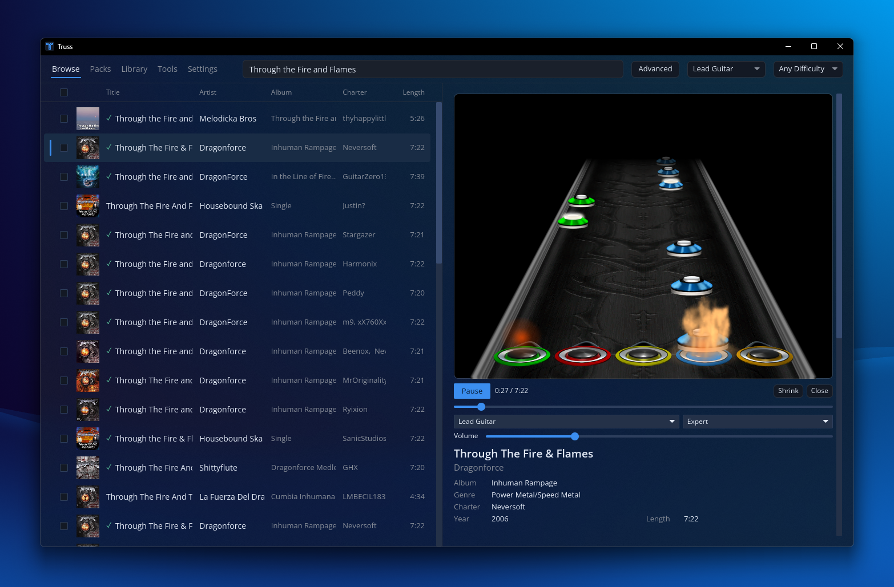
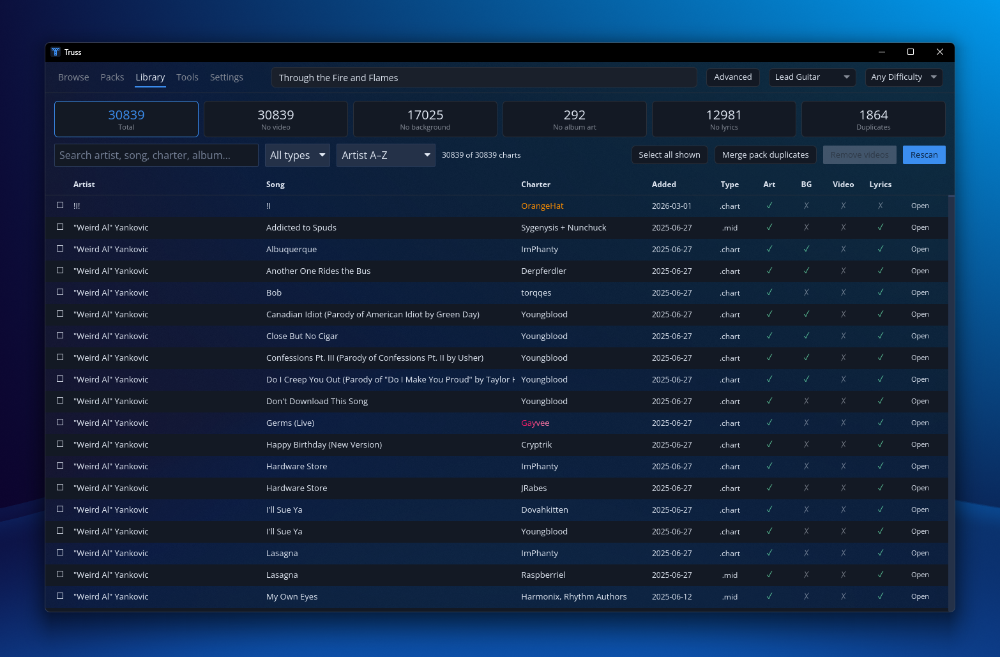

# Truss

A native Rust rewrite of [Bridge](https://github.com/Geomitron/Bridge) (formerly "Bridge RS"):
search Chorus Encore and RhythmVerse and download charts straight into your Clone Hero / YARG
songs folder, then preview them, check leaderboards and difficulty, plan Star Power paths and
manage your library. One small .exe: no Electron, no installer, no Visual C++ runtime needed.


<table>
  <tr>
    <td><br>Chart preview</td>
    <td><br>Leaderboards</td>
  </tr>
  <tr>
    <td><br>Advanced search</td>
    <td><br>Library</td>
  </tr>
  <tr>
    <td><br>Settings</td>
    <td></td>
  </tr>
</table>

On top of Bridge:

- **RhythmVerse** as a second chart source (Settings > Chart sources): its Clone Hero charts
  appear alongside Encore's (newest first, mixed by upload date), and download or preview from
  RhythmVerse, Google Drive or MediaFire (.zip, .7z, .rar, .sng). Truss keeps a local copy of
  RhythmVerse's chart list for instant search. RhythmVerse has no public API, so this may stop
  working if the site changes.
- **Scene Switcher** for OBS (Tools tab): switches scenes when Clone Hero starts and ends a song,
  shows the Ouvert request queue, Next song via Ouvert or a Twitch chat command; settings shared
  with the standalone [CH Scene Switcher](https://github.com/graindead/chswitcher).
- **Leaderboards**: the top 50 Clone Hero scores for a chart, including RhythmVerse charts and
  Encore charts whose listed hashes are out of date (Truss reads the chart and works them out).
- **Fretwork tiers**: hover a difficulty to see where the chart lands on Fretwork's scale, or turn
  them on next to every difficulty in Settings.
- **Frosted glass** (beta, Windows): the window blurs what's behind it (Settings > Appearance >
  Transparency). Needs small patches to iced, kept in `vendor/` (see `vendor/README.md`).
- **Star Power paths** (Tools tab): works out the best Star Power path for a chart in your
  library and draws it, like CHOpt. It's a Rust port of CHOpt built into Truss, with Clone Hero
  scoring (standard and precision) for guitar, bass, rhythm, keys and co-op, and CHOpt's squeeze,
  early whammy, video calibration, speed and lefty options; results match CHOpt 1.19.
- **Library** page for the charts you already have: click a chart to open its details (album art,
  difficulties with Fretwork tiers, a preview played from your own copy, the leaderboard), find
  charts missing art, backgrounds, video or lyrics, spot duplicates, and move charts to the
  Recycle Bin. Search results you already own get a ✓. The library is remembered between runs, so
  it's ready as soon as Truss opens.
- **Difficulty graphs**: Fretwork's difficulty over the song for each instrument (the same graph
  as [Truss Index](https://graindead.github.io/truss-index/)), with the values under the mouse.
- **Coloured names**: song names, artists and charters show the colours charters gave them for
  Clone Hero (can be turned off in Settings).
- **Uses what you already have**: previews, leaderboards and Fretwork tiers read charts in your
  library instead of downloading them again.

## Build

```
cargo build --release
```

The binary is `target/release/truss.exe` (single file, ~22 MB, with the C runtime linked in so it
runs on a fresh Windows install). To build without RhythmVerse:
`cargo build --release --no-default-features`.

## Layout

- `src/api.rs`: Encore search API client and album-art fetch (thumbnails decoded off the UI thread)
- `src/sng.rs`: streaming `.sng` extractor (writes files to disk as bytes arrive)
- `src/download.rs`: download pipeline, folder naming, filename sanitizing
- `src/settings.rs`: settings stored in `%APPDATA%\truss\config\settings.json` (moved from the old `bridge-rs` folders on first start)
- `src/chart.rs`: `.chart`/`.mid` note parser ported from scan-chart (verified against Encore's track hashes)
- `src/audio.rs`: multi-stem audio playback (libopus + symphonia, lock-free buffer, sample-accurate clock)
- `src/textures.rs`: preview artwork, cached on disk after first use
- `src/preview.rs`, `src/preview_panel.rs`: chart preview renderer and player controls
- `src/advanced.rs`: advanced search form (text/exact/exclude filters, ranges, feature flags)
- `src/library.rs`: scans library folders (song.ini / .sng metadata): the local chart catalog, its cache, and "Already in your library"
- `src/library_ui.rs`: Library page (chart details, missing art/background/video/lyrics, duplicates, search, delete to Recycle Bin)
- `src/tools_ui.rs`: Tools page (Star Power paths, Scene Switcher; the Issue scanner is hidden for now)
- `src/chopt/`, `src/path_ui.rs`: Star Power path optimiser (Rust port of CHOpt) and its page
- `src/fretwork.rs`, `src/curves.rs`, `src/graph.rs`: Fretwork difficulty tiers, difficulty-over-time curves and their graph
- `src/rich.rs`: Clone Hero's colour/bold/italic tags in song names
- `src/scenes.rs`, `src/scenes_ui.rs`: OBS scene switcher (OBS WebSocket 5), Ouvert queue, Twitch sign-in
- `src/rhythmverse.rs`, `src/rv_catalog.rs`, `src/rv_ui.rs`: RhythmVerse search, local chart list (SQLite), downloads
- `src/zip_ranges.rs`: fetches only the needed files from a remote .zip (skips videos) with HTTP range requests
- `src/lyrics.rs`: which library charts have lyrics (cached)
- `src/issues.rs`: chart issue scanner (port of scan-chart's checks) and the Excel report
- `src/vlist.rs`: virtualized list for 30k+ row tables
- `src/extras.rs`: chart details: library badge, detected issues, version picker, Google Drive link
- `src/main.rs`: iced UI (click column headers to sort; Ctrl/Shift-click to select several, then
  download them through the queue, 2 at a time)

## Updates and releases

Truss checks this repo's latest GitHub release when it starts (Settings > Updates), and can
download it, verify its SHA-256 and restart into it.

To publish a release, set `version` in `Cargo.toml`, commit, then push a matching tag:

```
git tag v0.2.0
git push origin main v0.2.0
```

GitHub Actions (`.github/workflows/release.yml`) runs the tests, builds `truss.exe` and publishes
it with `truss.exe.sha256`.

## Tests

```
cargo test --release
```

Network test that checks the parser against Encore: `TRUSS_TEST_ENCORE=1 cargo test --release track_hashes`

Compare the issue scanner with Encore's results: `TRUSS_TEST_ENCORE=1 cargo test --release issues_match_encore -- --nocapture`

Time a scan of a real library: `TRUSS_TEST_LIBRARY="C:/path/to/Songs" cargo test --release scan_real -- --nocapture`

## Not yet ported from Bridge

Report issue, UI zoom, custom themes.

## Credits and licence

Licensed GPL-3.0 (see `LICENSE`), like [Bridge](https://github.com/Geomitron/Bridge), which it
is a port of. The chart parser, issue checks and preview are ported from Geomitron's
[scan-chart](https://github.com/Geomitron/scan-chart) and
[chart-preview](https://github.com/Geomitron/chart-preview) (MIT). Fretwork difficulty tiers and
graphs are ported from Staycation's [Fretwork](https://github.com/Staycation44/fretwork) (MIT).
Star Power paths are a Rust port of Raymond Wright's
[CHOpt](https://github.com/GenericMadScientist/CHOpt) (GPL-3.0). The full list,
including the libraries Truss is built with, is under Settings > Credits.
