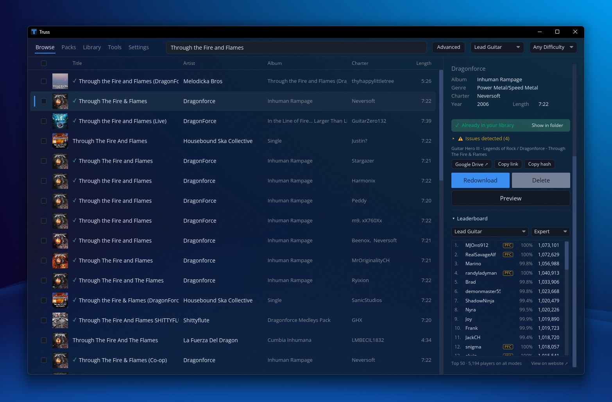
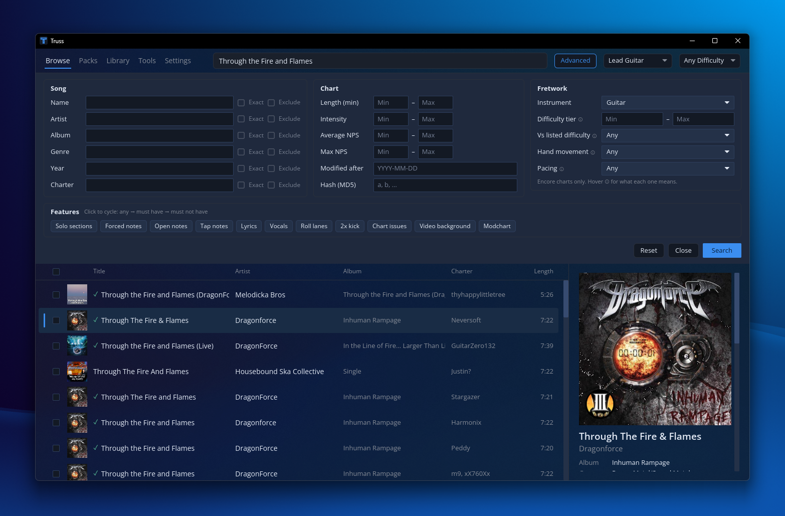
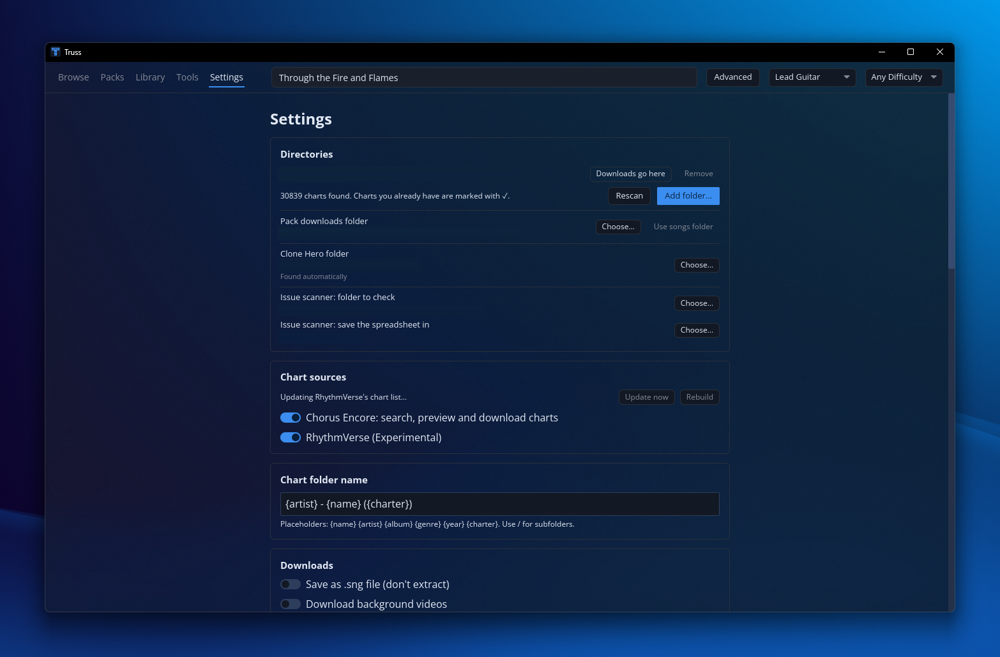

# Truss

Truss is a rewrite of [Bridge](https://github.com/Geomitron/Bridge) in Rust. Search Chorus
Encore (and RhythmVerse, if you turn it on), pick some charts, and they land straight in your
Clone Hero or YARG songs folder.

It's a single .exe. There's no installer and nothing else to set up: download it and run it.


<table>
  <tr>
    <td><br>Chart preview</td>
    <td><br>Leaderboards</td>
  </tr>
  <tr>
    <td><br>Advanced search</td>
    <td><br>Library</td>
  </tr>
  <tr>
    <td><br>Settings</td>
    <td></td>
  </tr>
</table>

## What it does

**Search and download.** Search Encore, tick as many charts as you like, and download them in one
go. Downloads run in the background, and a small button in the corner shows how far along they
are. Charts you already have get a ✓ in the results. New uploads show up while Truss is open:
it checks every few minutes, no restart needed.

**Packs.** The Packs tab lists the chart packs, setlists, monthly packs and full albums posted on
[Custom Songs Central](https://customsongscentral.com/), newest first, with a filter and
categories. Click one to read its description and download it: packs go through the same
download queue as charts, into a folder named after the pack. Packs go to your songs folder,
or to a separate pack folder if you choose one in Settings > Library folders. Truss downloads
from the site's own server, Google Drive (files and folders) and MEGA (file links), and unpacks
.zip, .7z and .rar for you. The odd pack hosted anywhere else opens in your browser instead.
Under "Game setlists" are the Guitar Hero and Rock Band games (and their DLC) converted for
Clone Hero, as listed in the community's Master List spreadsheet; they go into a Game Setlists
folder. Install gets each of a game's charts on its own from Chorus Encore (a handful from
RhythmVerse), so only the ones you don't have are downloaded; Download archive gets the
spreadsheet's whole archive from Google Drive instead, which can hit Drive's daily download
limit (Truss tells you when it has).
Each pack shows whether you already have it ("Installed", or "12 of 18 charts"), wherever
your charts are and however they're organised, and you can hide the ones you have.

**Previews.** Watch a chart scroll by before you download it. For charts you already have, the
preview plays from your own copy.

**RhythmVerse.** Turn it on in Settings > Chart sources and its Clone Hero charts show up next to
Encore's. They download from RhythmVerse, Google Drive or MediaFire (.zip, .7z, .rar or .sng).
Truss keeps its own copy of RhythmVerse's chart list on your PC, so searching it is instant,
and tops it up from RhythmVerse every few minutes.
RhythmVerse has no public API, so this could stop working if the site changes.

**Leaderboards.** See the top 50 Clone Hero scores for a chart. This works for RhythmVerse charts
too, and for Encore charts whose listed hashes are out of date, because Truss reads the chart and
works the hash out itself.

**How hard is it?** Hover a difficulty to see its [Fretwork](https://github.com/Staycation44/fretwork)
tier, or turn tiers on everywhere in Settings. The Library tab also graphs difficulty across the
song, so you can see where the hard parts are.

**Star Power paths.** CHOpt is built into the Tools tab. Pick a chart from your library and Truss
draws the best Star Power path for it. It covers guitar, bass, rhythm, keys and co-op with Clone
Hero's standard and precision scoring, and has CHOpt's squeeze, early whammy, video calibration,
speed and lefty options. Results match CHOpt 1.19.

**Your library.** Click any chart to see its details: album art, difficulties, a preview and its
leaderboard. The Library tab also shows which charts are missing album art, backgrounds, video or
lyrics, spots duplicates, and can move charts you don't want to the Recycle Bin. Your library is
remembered between runs, so it's ready as soon as Truss opens.

**Scene Switcher.** For streamers using OBS (Tools tab). It switches scenes when Clone Hero starts
and ends a song, shows your Ouvert request queue, and can skip to the next song through Ouvert or
a Twitch chat command. It shares its settings with the standalone
[CH Scene Switcher](https://github.com/graindead/chswitcher).

**Themes.** Pick a built-in theme, or make your own in Tools > Themes: choose each colour with a
picker and see a preview as you go. A theme can also decide whether the window is solid or
frosted glass (which blurs whatever is behind it, on Windows). Export a theme to share it as a
small file, and import ones other people made.

**Coloured names.** On the Library tab, song names, artists and charters show the colours
charters gave them in Clone Hero (you can turn this off).

## Not in Truss yet

A few things from Bridge haven't been ported: Report issue and UI zoom.

## Credits and licence

Truss would have nothing to show without the sites it reads from, and the charters and pack
makers whose work they host:

- [Chorus Encore](https://www.enchor.us) (by Geomitron): Browse's search, chart downloads,
  previews and chart details.
- [RhythmVerse](https://rhythmverse.co): the extra search results marked RV, and their downloads.
- [Custom Songs Central](https://customsongscentral.com/): the Packs tab's list, pack pages and
  download links.
- [Clone Hero Songs, Setlists, and Backgrounds/Highways Master List](https://docs.google.com/spreadsheets/d/13B823ukxdVMocowo1s5XnT3tzciOfruhUVePENKc01o/edit?gid=1870223413#gid=1870223413):
  the Packs tab's game setlists (Guitar Hero and Rock Band converted for Clone Hero).

Truss only finds and downloads charts; they belong to the people who made them.

Truss is licensed GPL-3.0 (see `LICENSE`), like [Bridge](https://github.com/Geomitron/Bridge),
which it's a port of. The chart parser, issue checks and preview are ported from Geomitron's
[scan-chart](https://github.com/Geomitron/scan-chart) and
[chart-preview](https://github.com/Geomitron/chart-preview) (MIT). Fretwork tiers and graphs are
ported from Staycation's [Fretwork](https://github.com/Staycation44/fretwork) (MIT). Star Power
paths are a Rust port of Raymond Wright's [CHOpt](https://github.com/GenericMadScientist/CHOpt)
(GPL-3.0). The full list, including the libraries Truss is built with, is in Settings > Credits.

---

## For developers

### Building

```
cargo build --release
```

That gives you `target/release/truss.exe`, a single file of about 22 MB. The C runtime is linked
in, so it runs on a fresh Windows install. To leave RhythmVerse out:
`cargo build --release --no-default-features`.

The frosted glass needs small patches to iced, which live in `vendor/` (see `vendor/README.md`).

### Tests

```
cargo test --release
```

Some tests need the network or a real library, and are off unless you ask for them:

- Check the chart parser against Encore: `TRUSS_TEST_ENCORE=1 cargo test --release track_hashes`
- Compare the issue scanner with Encore: `TRUSS_TEST_ENCORE=1 cargo test --release issues_match_encore -- --nocapture`
- Time a scan of a real library: `TRUSS_TEST_LIBRARY="C:/path/to/Songs" cargo test --release scan_real -- --nocapture`

### Releases and updates

Truss checks this repo's latest GitHub release when it starts (Settings > Updates). It can
download the new version, check its SHA-256 and restart into it.

To publish a release, set `version` in `Cargo.toml`, add a section for it to `CHANGELOG.md`,
commit, then push a matching tag:

```
git tag v0.2.0
git push origin main v0.2.0
```

GitHub Actions (`.github/workflows/release.yml`) runs the tests, builds `truss.exe` and publishes
it with `truss.exe.sha256`, using the CHANGELOG section as the release notes.

### Where things are

- `src/main.rs`: the iced UI, the downloads queue (2 at a time) and the results list
- `src/api.rs`: Encore search and album art (thumbnails are decoded off the UI thread)
- `src/download.rs`: downloading, folder naming and filename cleanup
- `src/sng.rs`: `.sng` extraction, writing files as the bytes arrive
- `src/zip_ranges.rs`: fetches only the files it needs from a remote .zip (skipping videos)
- `src/settings.rs`: settings, kept in `%APPDATA%\truss\config\settings.json`
- `src/chart.rs`: `.chart` / `.mid` parser ported from scan-chart (checked against Encore's track hashes)
- `src/audio.rs`: multi-stem audio playback (libopus and symphonia)
- `src/preview.rs`, `src/preview_panel.rs`, `src/textures.rs`: the chart preview and its controls
- `src/advanced.rs`: the Advanced search form
- `src/library.rs`, `src/library_ui.rs`, `src/lyrics.rs`: scanning your library, its cache, and the Library page
- `src/packs.rs`: the Packs page (reads Custom Songs Central's pack list)
- `src/game_setlists.rs`, `data/game-setlists.json`: the Packs page's game setlists, read from
  the Clone Hero Master List spreadsheet (the JSON is the built-in copy for when it can't be read)
- `src/game_sources.rs`, `data/game-sources.json`, `data/game-source-overrides.json`: where each
  game setlist chart is on Chorus Encore or RhythmVerse (official charters only). Built with
  `TRUSS_BUILD_GAME_SOURCES=data/game-sources.json cargo test --release build_game_sources -- --ignored --nocapture`
  from the pack index, Chorus and Truss's local RhythmVerse catalogue; it lists any chart it can't
  place, for the overrides' `names`
- `src/mega.rs`: downloading MEGA file links (MEGA's public API, files decrypted as they arrive)
- `src/pack_index.rs`, `data/pack-index.json`: which charts are in each pack. Built with
  `TRUSS_BUILD_PACK_INDEX=data/pack-index.json cargo test --release build_pack_index -- --nocapture`,
  which reads only each chart's song.ini where the archive allows it and skips packs already indexed
- `src/tools_ui.rs`: the Tools page
- `src/theme_maker.rs`: Tools > Themes (custom themes, colour picker, import and export)
- `src/chopt/`, `src/path_ui.rs`: the Star Power path optimiser (Rust port of CHOpt) and its page
- `src/fretwork.rs`, `src/curves.rs`, `src/graph.rs`: Fretwork tiers, difficulty curves and the graph
- `src/rhythmverse.rs`, `src/rv_catalog.rs`, `src/rv_ui.rs`: RhythmVerse search, its local chart list (SQLite) and downloads
- `src/scenes.rs`, `src/scenes_ui.rs`: the OBS Scene Switcher (OBS WebSocket 5), Ouvert queue and Twitch sign-in
- `src/issues.rs`: chart issue checks (ported from scan-chart), currently hidden in the app
- `src/extras.rs`: extra chart details (library badge, detected issues, version picker, Google Drive link)
- `src/rich.rs`: Clone Hero's colour, bold and italic tags in names
- `src/vlist.rs`: a virtualized list, so tables of 30,000+ charts stay smooth
