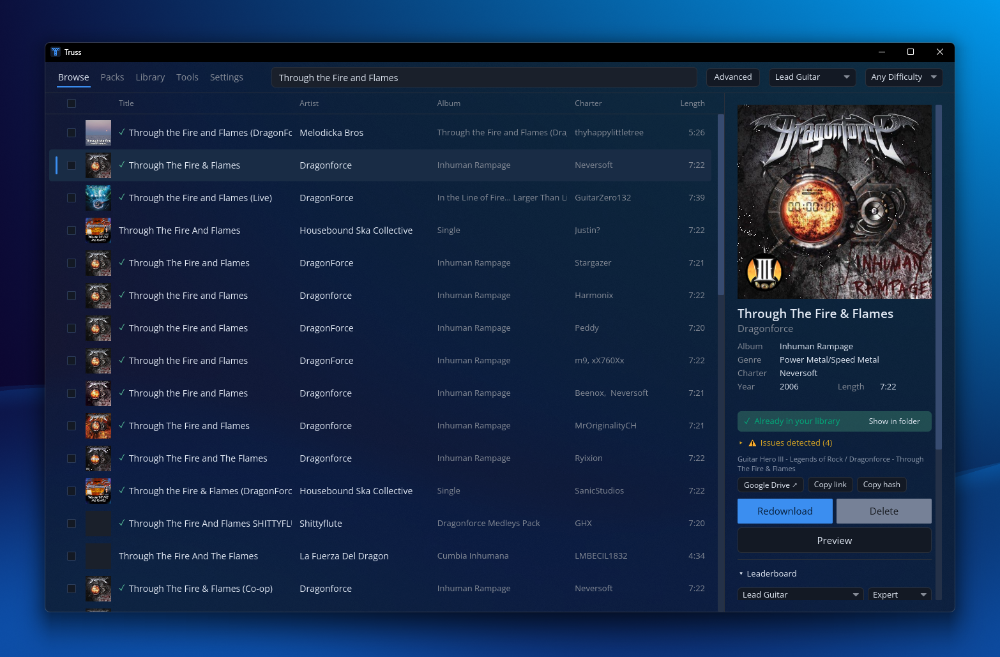

# Truss

> [!IMPORTANT]
> **AI disclosure:** Truss is written with an AI model (Anthropic's Claude, through Claude Code).
> All features are tested before release.

[](https://app.codacy.com/gh/graindead/truss/dashboard)

Truss is a chart manager for Clone Hero and YARG. It searches Chorus Encore (and RhythmVerse, if
you turn it on), downloads charts and packs straight into your songs folder, and keeps your
library in order. It started as a rewrite of [Bridge](https://github.com/Geomitron/Bridge) in
Rust.

It's a single .exe (about 31 MB, Windows). There's no installer: download it and run it.



<table>
  <tr>
    <td><br>Chart preview</td>
    <td><br>Leaderboards</td>
  </tr>
  <tr>
    <td><br>Advanced search</td>
    <td><br>Library</td>
  </tr>
  <tr>
    <td><br>Settings</td>
    <td></td>
  </tr>
</table>

## Features

**Search and download.** Search Encore, and RhythmVerse too if you turn it on in Settings, tick
as many charts as you like and download them in one go. Downloads run in the background. Charts
you already have are marked with a ✓, and new uploads show up while Truss is open.

**Packs.** Chart packs, setlists, monthly packs and full albums from
[Custom Songs Central](https://customsongscentral.com/), plus the Guitar Hero and Rock Band games
converted for Clone Hero. Truss downloads from the site, Google Drive and MEGA, unpacks .zip, .7z
and .rar, and shows which packs you already have.

**Chart preview.** Watch a chart play before you download it. With Clone Hero installed, the
preview is drawn the way the game draws it, using the game's own files: its camera, lane spacing,
strike rings, rails, notes and timing, sustains that glow while held, hit flames and sparks, and
beat lines. It follows your Clone Hero profile too: your highway, colour profile, note speed,
highway length and lefty flip. Jump to a section, loop it, or slow it down to 50% without
changing the pitch.

**Leaderboards and your scores.** See the top Clone Hero scores for any chart, including
RhythmVerse charts. The Library tab shows your own best score on every chart, and can list the
ones you nearly full-combo'd and unplayed charts at your level.

**Player Stats.** Tools > Player Stats shows your Clone Hero player card, with averages, hardest
FCs, near-FCs, accuracy by Fretwork tier and strong suits. Type any username to see theirs, or
compare two players side by side, including who's ahead on the charts you've both played.

**Difficulty.** [Fretwork](https://github.com/Staycation44/fretwork) tiers on every chart. For
charts in your library, the Library tab also graphs how hard each part of the song is.

**Star Power paths.** CHOpt is built in (Tools > Pathing). Pick a chart and Truss draws the best Star
Power path, matching CHOpt 1.19.

**Library.** Shows which charts are missing album art, backgrounds, video or lyrics, finds
duplicates and exact copies, and moves charts you don't want to the Recycle Bin.

**Color Profiles and themes.** Edit Clone Hero colour profiles with a live preview of the game's
own notes, and pick or make a theme for Truss itself.

**Profile Editor.** Edit your Clone Hero profile: colour your name (one colour or a gradient, bold
or italic), and change its colour profile, note speed and other settings. A backup is kept.

**Scene Switcher.** For OBS streamers: switches scenes when a song starts and ends, and works
with Ouvert song requests. Shares its settings with
[CH Scene Switcher](https://github.com/graindead/chswitcher).

## Performance

Truss is a native Rust app drawn on the graphics card with [iced](https://iced.rs), not a web
page in an Electron wrapper. There's no bundled browser, so it opens instantly and runs light.

- Charts show in Browse about a second after opening.
- About 200 MB of memory with a 30,000-chart library open, about 250 MB while a preview plays.
- Long lists stay smooth: only the rows on screen are built.
- Starting up only looks at chart folders that are new or changed, in the background at low
  priority, so it's quick even on a slow hard drive.
- RhythmVerse's chart list is kept on your PC, so searching it is instant.
- Album art and the game's pictures are cached once and reused.

## Not in Truss yet

Report issue and UI zoom from Bridge haven't been ported.

## Open source

Truss is fully open source under GPL-3.0, and it always will be. All of its code is here, and
anyone can read it, build it or change it.

Truss builds on tools and sites made by other people in the community (listed below). If you
made one of them and want it taken out of Truss, open an issue or get in touch and I'll remove
it, no questions asked.

## Credits and licence

Truss would have nothing to show without the sites it reads from, and the charters and pack
makers whose work they host:

- [Chorus Encore](https://www.enchor.us) (by Geomitron): Browse's search, chart downloads,
  previews and chart details.
- [RhythmVerse](https://rhythmverse.co): the extra search results marked RV, and their downloads.
- [Custom Songs Central](https://customsongscentral.com/): the Packs tab's list, pack pages and
  download links.
- [Clone Hero Songs, Setlists, and Backgrounds/Highways Master List](https://docs.google.com/spreadsheets/d/13B823ukxdVMocowo1s5XnT3tzciOfruhUVePENKc01o/edit?gid=1870223413#gid=1870223413):
  the Packs tab's game setlists (Guitar Hero and Rock Band converted for Clone Hero).

Truss only finds and downloads charts; they belong to the people who made them.

Truss is licensed GPL-3.0 (see `LICENSE`), like [Bridge](https://github.com/Geomitron/Bridge),
which it's a port of. The chart parser, issue checks and preview are ported from Geomitron's
[scan-chart](https://github.com/Geomitron/scan-chart) and
[chart-preview](https://github.com/Geomitron/chart-preview) (MIT). Fretwork tiers and graphs are
ported from Staycation's [Fretwork](https://github.com/Staycation44/fretwork) (MIT). Star Power
paths are a Rust port of Raymond Wright's [CHOpt](https://github.com/GenericMadScientist/CHOpt)
(GPL-3.0). The full list, including the libraries Truss is built with, is in Settings > Credits.

---

## For developers

### Building

```
cargo build --release
```

That gives you `target/release/truss.exe`, a single file of about 31 MB. The C runtime is linked
in, so it runs on a fresh Windows install. To leave RhythmVerse out:
`cargo build --release --no-default-features`.

The frosted glass needs small patches to iced, which live in `vendor/` (see `vendor/README.md`).

### Tests

```
cargo test --release
```

Some tests need the network or a real library, and are off unless you ask for them:

- Check the chart parser against Encore: `TRUSS_TEST_ENCORE=1 cargo test --release track_hashes`
- Compare the issue scanner with Encore: `TRUSS_TEST_ENCORE=1 cargo test --release issues_match_encore -- --nocapture`
- Time a scan of a real library: `TRUSS_TEST_LIBRARY="C:/path/to/Songs" cargo test --release scan_real -- --nocapture`

### Releases and updates

Truss checks this repo's latest GitHub release when it starts (Settings > Updates). It can
download the new version, check its SHA-256 and restart into it.

To publish a release, set `version` in `Cargo.toml`, add a section for it to `CHANGELOG.md`,
commit, then push a matching tag:

```
git tag v0.2.0
git push origin main v0.2.0
```

GitHub Actions (`.github/workflows/release.yml`) runs the tests, builds `truss.exe` and publishes
it with `truss.exe.sha256`, using the CHANGELOG section as the release notes.

### Where things are

- `src/main.rs`: the iced UI, the downloads queue (2 at a time) and the results list
- `src/api.rs`: Encore search and album art (thumbnails are decoded off the UI thread)
- `src/download.rs`: downloading, folder naming and filename cleanup
- `src/sng.rs`: `.sng` extraction, writing files as the bytes arrive
- `src/zip_ranges.rs`: fetches only the files it needs from a remote .zip (skipping videos)
- `src/settings.rs`: settings, kept in `%APPDATA%\truss\config\settings.json`
- `src/chart.rs`: `.chart` / `.mid` parser ported from scan-chart (checked against Encore's track hashes)
- `src/audio.rs`: multi-stem audio playback (libopus and symphonia)
- `src/preview.rs`, `src/preview_panel.rs`, `src/textures.rs`: the chart preview and its controls
- `src/advanced.rs`: the Advanced search form
- `src/library.rs`, `src/library_ui.rs`, `src/lyrics.rs`: scanning your library, its cache, and the Library page
- `src/packs.rs`: the Packs page (reads Custom Songs Central's pack list)
- `src/game_setlists.rs`, `data/game-setlists.json`: the Packs page's game setlists, read from
  the Clone Hero Master List spreadsheet (the JSON is the built-in copy for when it can't be read)
- `src/game_sources.rs`, `data/game-sources.json`, `data/game-source-overrides.json`: where each
  game setlist chart is on Chorus Encore or RhythmVerse (official charters only). Built with
  `TRUSS_BUILD_GAME_SOURCES=data/game-sources.json cargo test --release build_game_sources -- --ignored --nocapture`
  from the pack index, Chorus and Truss's local RhythmVerse catalogue; it lists any chart it can't
  place, for the overrides' `names`
- `src/mega.rs`: downloading MEGA file links (MEGA's public API, files decrypted as they arrive)
- `src/pack_index.rs`, `data/pack-index.json`: which charts are in each pack. Built with
  `TRUSS_BUILD_PACK_INDEX=data/pack-index.json cargo test --release build_pack_index -- --nocapture`,
  which reads only each chart's song.ini where the archive allows it and skips packs already indexed
- `src/tools_ui.rs`: the Tools page
- `src/theme_maker.rs`: Tools > Themes (custom themes, colour picker, import and export)
- `src/chopt/`, `src/path_ui.rs`: the Star Power path optimiser (Rust port of CHOpt) and its page
- `src/fretwork.rs`, `src/curves.rs`, `src/graph.rs`: Fretwork tiers, difficulty curves and the graph
- `src/rhythmverse.rs`, `src/rv_catalog.rs`, `src/rv_ui.rs`: RhythmVerse search, its local chart list (SQLite) and downloads
- `src/scenes.rs`, `src/scenes_ui.rs`: the OBS Scene Switcher (OBS WebSocket 5), Ouvert queue and Twitch sign-in
- `src/issues.rs`: chart issue checks (ported from scan-chart), currently hidden in the app
- `src/extras.rs`: extra chart details (library badge, detected issues, version picker, Google Drive link)
- `src/rich.rs`: Clone Hero's colour, bold and italic tags in names
- `src/players/`, `data/fretwork-ratings.bin.gz`: Tools > Player Stats (ported from Truss Stats),
  and the Fretwork ratings it matches scores to
- `src/profile_editor.rs`: Tools > Profile Editor (Clone Hero's profiles.ini)
- `src/vlist.rs`: a virtualized list, so tables of 30,000+ charts stay smooth
